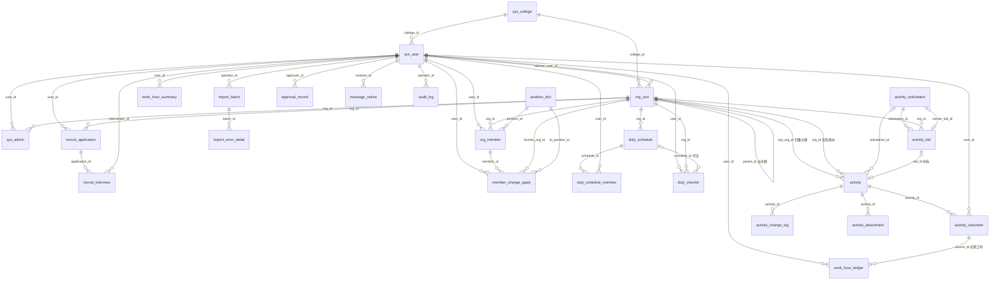
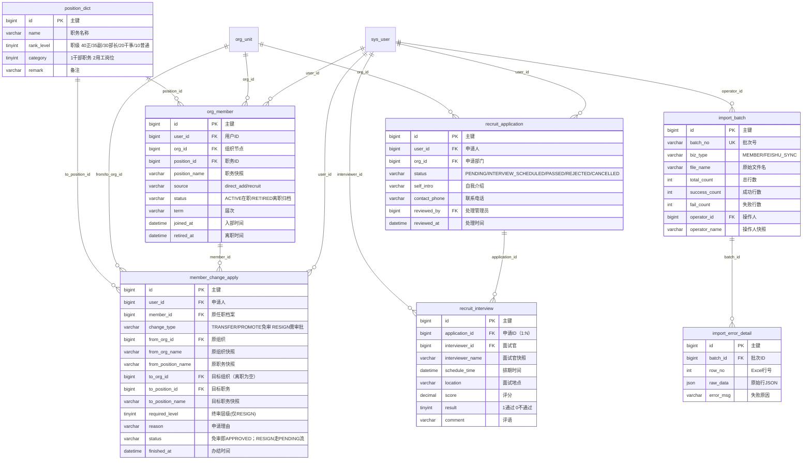
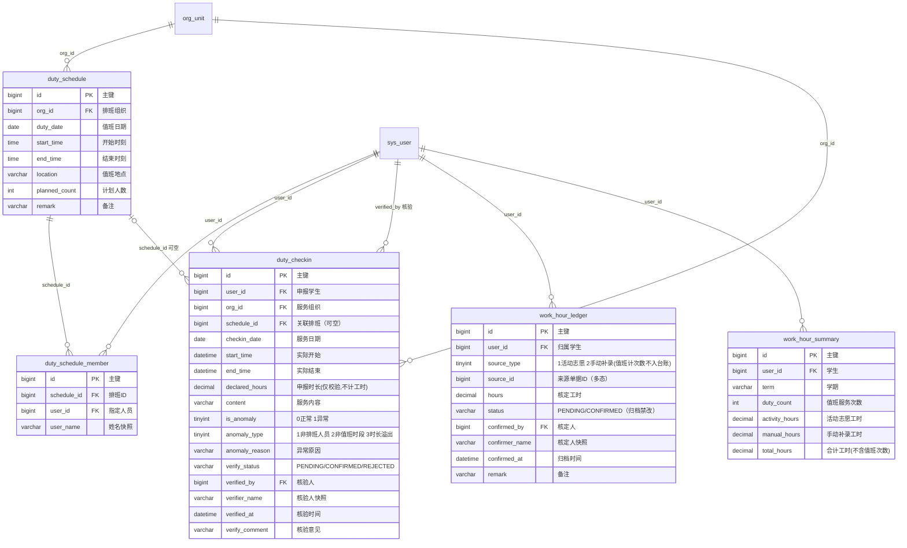
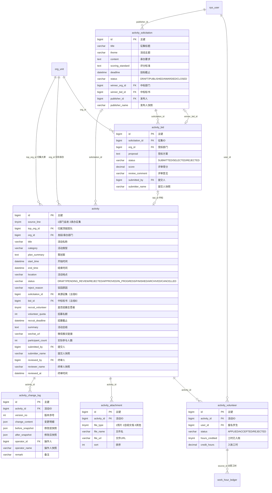
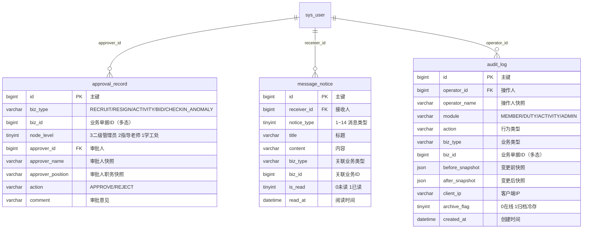

# 学生工作处系统 · 数据库 E-R 实体关系图

> 数据库：`sg_platform`（MySQL 8.0 / InnoDB / utf8mb4_0900_ai_ci）  
> 规范：雪花主键 / 全逻辑外键（无物理外键）/ 逻辑删除 / 快照冗余防篡改  
> 所有表均含公共审计字段 `created_by` / `updated_by` / `created_at` / `updated_at` / `is_deleted`，图中统一省略。

---

## 一、数据表清单（5 域 · 25 表）

| 领域 | 表名 | 说明 |
|------|------|------|
| 一 · 用户与组织 | `sys_user` | 用户影子表（飞书身份源） |
| | `sys_college` | 二级学院字典表 |
| | `position_dict` | 职务/岗位字典表 |
| | `org_unit` | 组织单元树表（自关联） |
| | `sys_admin` | 管理员数据范围授权表 |
| 二 · 人事流转 | `org_member` | 成员任职档案 |
| | `recruit_application` | 纳新申请表 |
| | `recruit_interview` | 面试记录表（1:N 多轮） |
| | `member_change_apply` | 人事流转记录单（调动/晋升免审，离职需审批） |
| | `import_batch` | 批量导入批次表 |
| | `import_error_detail` | 导入错误明细表 |
| 三 · 值班工时 | `duty_schedule` | 值班排班表 |
| | `duty_schedule_member` | 排班指定人员表 |
| | `duty_checkin` | 值班/志愿服务打卡申报表 |
| | `work_hour_ledger` | 工时台账流水表（归档禁改） |
| | `work_hour_summary` | 工时台账学期汇总表 |
| 四 · 活动 | `activity` | 活动主表（自发+承办双主线） |
| | `activity_solicitation` | 学工处承办征集表 |
| | `activity_bid` | 部门承办竞标表 |
| | `activity_change_log` | 活动变更留痕表 |
| | `activity_attachment` | 活动附件表 |
| | `activity_volunteer` | 活动志愿者表 |
| 五 · 通用支撑 | `approval_record` | 通用审批记录表 |
| | `message_notice` | 站内消息通知表 |
| | `audit_log` | 安全审计日志表（禁 UPDATE/DELETE） |

---

## 二、全局关系总览（仅关系，不列字段）



---

## 三、分领域实体关系图（完整字段）

### 3.1 领域一 · 用户与组织域

```mermaid
erDiagram
    sys_college ||--o{ sys_user : "college_id"
    sys_college ||--o{ org_unit : "college_id"
    org_unit ||--o{ org_unit : "parent_id 自关联"
    sys_user ||--o{ org_unit : "advisor_user_id"
    sys_user ||--o{ sys_admin : "user_id"
    org_unit ||--o{ sys_admin : "org_id"

    sys_user {
        bigint id PK "主键（雪花）"
        varchar feishu_user_id UK "飞书用户ID"
        varchar name "姓名"
        varchar student_no IDX "学号（支持批量导入匹配）"
        varchar employee_no IDX "教工号（教师专属）"
        tinyint user_type "1学生 2教师"
        bigint college_id FK "所属学院"
        varchar major "专业"
        varchar grade "年级"
        varchar class_name "行政班级"
        varchar phone "手机号"
        varchar email "邮箱"
        varchar avatar_url "头像"
        tinyint status "1正常 0禁用"
        datetime last_login_at "最近登录时间"
    }
    sys_college {
        bigint id PK "主键"
        varchar name "学院名称"
        varchar code UK "学院编码"
        int sort "排序"
    }
    org_unit {
        bigint id PK "主键"
        bigint parent_id FK "父节点，顶层为0"
        varchar ancestors "物化路径"
        varchar name "组织名称"
        tinyint org_type "1顶层团队 2二级部门 3职能组 4校级委员会 5院级分委"
        bigint college_id FK "所属学院（仅院级分委）"
        bigint advisor_user_id FK "指导老师（仅顶层团队）"
        tinyint is_recruiting "纳新开关"
        varchar recruit_notice "纳新说明"
        int sort "同级排序"
        tinyint status "1启用 0停用"
    }
    sys_admin {
        bigint id PK "主键"
        bigint user_id FK "用户ID"
        tinyint scope_level "1学工处 2指导老师；Level3部长由org_member派生"
        varchar admin_role "SCHOOL_ADMIN/ADVISOR"
        bigint org_id FK "管辖组织，0=全校"
    }
```

### 3.2 领域二 · 人事流转域



### 3.3 领域三 · 值班工时域



### 3.4 领域四 · 活动域



### 3.5 领域五 · 通用支撑域



---

## 四、设计约定

1. **逻辑外键**：全部关联由应用层保证，数据库不建物理外键。
2. **多态关联**：
   - `work_hour_ledger.source_id` + `source_type` → `activity_volunteer` / 导入批次（值班按服务次数统计，不产生工时流水）。
   - `approval_record.biz_id`、`message_notice.biz_id`、`audit_log.biz_id` + `biz_type` → 各业务单据。
3. **组织树**：`org_unit.parent_id = 0` 为顶层团队，`ancestors` 物化路径支持子树 LIKE 前缀查询。
4. **逻辑删除**：业务表统一 `is_deleted`，唯一索引合并该字段（`uk_xxx_del`），删除后允许重录。
5. **快照冗余**：姓名、职务、组织名等以快照字段冗余存储，防止历史单据被源头修改篡改。
